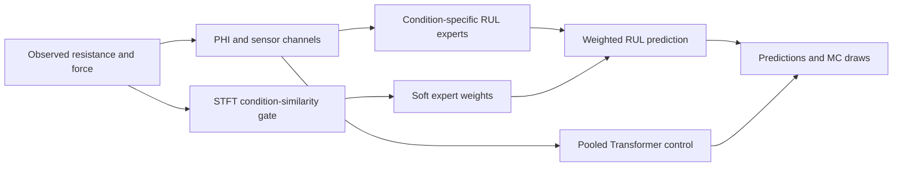

# Reliability-Aware RUL Prognostics for Semiconductor Test Socket Micro-Pins

[](https://www.python.org/downloads/)
[](https://pytorch.org/)
[](LICENSE)

Revision research implementation for remaining useful life (RUL) prediction
from contact resistance and force measurements of semiconductor test socket
micro-pins. This is a separate public repository derived from
[reliability-aware-rul](https://github.com/juhun7777/reliability-aware-rul).

**Authors:** Juhun Lee, Kihyun Kim, Hyo-Young Kim
**Affiliation:** Tech University of Korea, Department of Mechatronics Engineering

## Overview

The central idea is to compare an observed signal with the learned operating
conditions and use that similarity to combine condition-specific RUL predictions.
The current need not be supplied as an inference label.

The repository provides two clearly separated execution paths:

1. **Bi-LSTM workflow (`train.py`):** the original network family with repaired
   split, checkpoint, observation identity and export handling.
2. **Revision workflow (`train_revision.py`):** pooled Transformer, three
   independent condition experts and a shared Transformer encoder with three
   condition-specific heads, compared with the same observations.

These are research protocols. Their outputs must be evaluated on the declared
data and split. The additional experiments examine improvement opportunities
in the current data. Original-parent relationships between training and
evaluation data are recorded; evaluation on new independent specimens remains
a follow-up task.

## Development Results

The original idea is retained: PHI enters the RUL experts, and an observed-signal
similarity gate combines their outputs. The first improvement keeps the existing
Bi-LSTM experts fixed and changes the gate. Applying the same improved gate to
Transformer experts is an additional comparison, not a decision to replace the
manuscript's main model.

### Existing Experts and Gate Improvement

| Three-expert configuration | MAE (cycles) | RMSE (cycles) |
|:---|---:|---:|
| Bi-LSTM + PHI + original STFT soft | 16,436 | 21,960 |
| Same Bi-LSTM experts + improved similarity gate | 9,301 | 11,308 |
| Transformer + PHI + same improved gate | 8,223 | 10,210 |

These are three-seed means (42, 43, 44), each evaluated at the same 45 observations
(15 files at 70%, 80%, 90%). PHI remains an expert input in every row. The improved
gate uses resistance-based DC amplitude/trend features, not PHI as a gate input.
Its main information is equivalent to a Hann-weighted moving mean. The archived
regressors in this stage were selected using the earlier val procedure; their
capacity and training are not a fully matched backbone comparison.

### Separate Transformer Retraining

The next stage selects epochs within training groups and refits the selected
training schedule. Its 30-draw MC means, averaged over three seeds, are:

| Configuration | MAE (cycles) | RMSE (cycles) |
|:---|---:|---:|
| Pooled Transformer | 10,521 | 12,795 |
| Shared encoder with three expert heads + STFT soft | 9,838 | 12,213 |
| Shared soft + pooled prediction, fixed 50:50 | 9,430 | 11,314 |

This is a separate training/selection and inference protocol. Do not rank 8,223
and 9,430 as if only the architecture changed. The supplied results examine
improvement possibilities in the current development data; independent specimen
evaluation remains a follow-up task.

See the [Korean experiment summary](docs/development_results_ko.md),
[aggregate results and controls](examples/development_results.csv), and
[actual Transformer settings record](examples/development_transformer_config.json).
The JSON records settings; the entrypoint takes CLI flags, not `--config`.

## Method

- **PHI:** a configurable residual relative to
  `R_ideal(F) = alpha * F^(-1/3) + beta`, with an observed initial baseline.
  The legacy values `alpha=2.34`, `beta=0.133` are configuration constants;
  physical units and calibration should be documented for each dataset.
- **Condition-similarity gate:** resistance-prefix STFT features produce
  continuous weights over the three training conditions, `0A`, `0.5A`, `1.0A`.
  The primary revision gate uses the DC component and observed-cycle
  normalization. DC is a Hann-weighted moving mean, so any benefit alone does
  not establish that nonzero frequency components are necessary.
- **Expert combination:** soft, hard and uniform weights share the same expert
  outputs. A fixed 50:50 pooled/expert combination is an additional control.
- **MC dropout:** repeatable draws, their mean and standard deviation are
  exported. A dropout standard deviation is not automatically a calibrated
  confidence interval.



The original Bi-LSTM illustration is retained for reference in
[`assets/framework.jpg`](assets/framework.jpg). It does not depict the revised
shared Transformer architecture.

## Project Structure

```text
reliability-aware-rul-revision/
├── assets/                   # Original framework illustrations
├── config/
│   └── config.py             # Bi-LSTM workflow configuration
├── data/
│   ├── train/{0A,0.5A,1.0A}/
│   └── test/{0.3A,0.7A,0.9A}/
├── models/
│   ├── lstm.py               # Attention Bi-LSTM
│   ├── ensemble_lstm.py      # Legacy ensemble interface
│   └── condition_transformer.py
├── utils/
│   ├── preprocessing.py      # PHI and STFT+MLP preprocessing
│   ├── condition_gate.py     # Revision condition-similarity gate
│   ├── revision_data.py      # Explicit manifest and train-only scaling
│   └── metrics.py
├── examples/sample_manifest.csv
├── tools/                    # Replay, frozen-component audits and comparisons
├── tests/
├── docs/
├── train.py                  # Repaired Bi-LSTM execution path
├── train_revision.py         # Revision model comparisons
├── requirements.txt
└── README.md
```

## Getting Started

### 1. Installation

```bash
git clone https://github.com/juhun7777/reliability-aware-rul-revision.git
cd reliability-aware-rul-revision
pip install -r requirements.txt
python -m unittest discover -s tests -v
```

Tested environment: Python 3.12, PyTorch 2.7.1, NumPy 1.26.4,
pandas 2.2.2, SciPy 1.16.3 and scikit-learn 1.5.1. GPU results can vary
with hardware and library versions. Training performs no model download.

### 2. Data Format

Each CSV contains:

```csv
cumulative_contact,res,force,RUL
```

Record the units, experimental termination criterion and original specimen
identity separately. The program does not infer whether a final `RUL=0`
represents physical failure or the end of a recorded test.

The same **18 public sample CSVs** as the original repository are bundled for
code verification. Folder names preserve the public sample organization.
The demonstration manifest uses file-hash groups, which are not authenticated
independent specimen IDs or proof of unseen-current generalization.
Full measurement data and trained checkpoints are not bundled.

### 3. Quick Execution Check

```bash
python train_revision.py --manifest examples/sample_manifest.csv --output results/demo --models shared --seeds 42 --epochs 2 --fixed-gate
```

This two-epoch command verifies execution; it is not a performance experiment.
Output folders must be new so previous results are not silently overwritten.

### 4. Revision Training and Evaluation

Create a manifest with `record_id,path,split,condition,group_id`:

```csv
record_id,path,split,condition,group_id
train01,/path/train/0A/pin01.csv,train,0A,original01
train02,/path/train/0.5A/pin02.csv,train,0.5A,original02
eval01,/path/val/0.3A/pin03.csv,val,0.3A,original03
```

This illustrates the schema, not a complete trainable dataset. All three
training conditions need multiple original groups for internal selection.
Original trajectories and their augmented descendants must share `group_id`.
Relative paths resolve against the manifest directory.

```bash
python train_revision.py --manifest /path/manifest.csv --output results/revision --models all --seeds 42 43 44 --mc-samples 30
```

Epochs and gate settings are selected using training groups only. The default
evaluation observations are 70%, 80%, 90%; neither those fractions nor final
lifetime/RUL are model inputs. Evaluation condition names are not gate inputs.
Parent-group overlap is rejected by default. The explicit
`--allow-development-overlap` option permits an annotated development replay,
not an independent specimen evaluation.

### 5. Bi-LSTM Workflow

Set the dataset paths and settings in `config/config.py`, then run:

```bash
python train.py
```

This repaired path can differ from the original execution: test-file
substitution was removed, the observation fraction is fixed, cycles come from
the measured column, gate groups are split before scaling, best checkpoints
are restored, and PHI uses an initial baseline by default. See the protocol for
the explicit historical full-trajectory-minimum calculator option.

`train.py` contains the repaired Bi-LSTM training path. The 9,301 result above
was obtained by reweighting archived experts in a separate follow-up experiment;
it is not a promised output of the default `python train.py` command. Both
backbones can use the resistance-only `STFTRateGate` after training, without
changing their PHI inputs. Export exact component outputs and weights to audit
that combination:

```bash
python tools/recompute_frozen_results.py --predictions /path/frozen_components.csv --output results/frozen_audit
```

The [input schema and interpretation](docs/development_results_ko.md#저장된-전문가-출력의-재계산)
distinguish a frozen-component audit from fitting a gate or retraining a model.
This deterministic tool does not replay MC uncertainty from component means.

## Model and Training Controls

| Setting | Revision workflow |
|:---|:---|
| Encoder | Transformer, width 128, 3 layers, 4 heads |
| Sequence | 200 rows; training stride 100 |
| Optimizer | AdamW, learning rate 5e-4, weight decay 1e-4 |
| Dropout | 0.1 |
| Loss | Huber, delta 0.5, target RUL / 100000 |
| Epoch selection | Internal original groups, maximum 50 epochs, patience 12 |
| Gate | STFT segment 256, overlap 128, Hann, no padding |
| PHI control | `--no-phi`, same network capacity |
| Spectral control | DC versus `--gate-bins nonzero_control` |

When the CSV step is 100 cycles, an STFT segment of 256 rows spans 25,600
cycles. Do not assign an acquisition frequency in Hz without measurement
timing information.

## Outputs and Reproduction

Runs save exact file/group/observation IDs, targets, component outputs, expert
weights, predictions, errors, selected epochs, scalers, configs, seeds, input
SHA256 hashes, and MC draws when enabled. MC uses the independent seed rule
`seed + 100000`; weighted draws are clipped at zero before their mean/std.

```bash
# Replay saved checkpoints and MC draws from the declared input files
python tools/replay_revision.py --run results/revision --manifest /path/manifest.csv --output results/replay

# Compare DC and added frequency bins using the same frozen regressors
python tools/compare_gate_bins.py --run results/revision --manifest /path/manifest.csv --output results/gate_bins

# Select pooled/expert mixing only on internal training calibration groups
python tools/calibrate_mixture.py --run results/revision --manifest /path/manifest.csv --output results/calibrated_mixture
```

The last two commands require a completed `--models all` run. All alternatives
must be retained when interpreting an improvement; selecting a configuration
after observing evaluation performance changes its evidential scope.

The NASA diagnostic in this implementation scales errors by 10,000 cycles and
reports `log10(1 + sum(asymmetric exponential penalties))`. It is not the
unscaled NASA challenge total. Perfect predictions score zero.

## Documentation

- [Bi-LSTM improvements and additional Transformer experiments (Korean)](docs/development_results_ko.md)
- [Revision protocol and definitions](docs/revision_protocol.md)
- [Changes from the original repository](docs/changes.md)
- [Calibration, noise and manuscript-question definitions](docs/revision_questions.md)
- [Archived original README](docs/legacy_readme.md)

Recalculate calibration/noise/table evidence from explicitly supplied inputs:

```bash
python tools/revision_evidence.py --manifest /path/manifest.csv --output results/evidence --table /path/table_viii.csv --static-fsr /path/fsr_points.csv
```

The script does not change measured CSV values or invent missing gain history.
Historical manuscript values are not advertised as newly reproduced results.

## License

MIT License. Original author attribution is retained; see [LICENSE](LICENSE).
